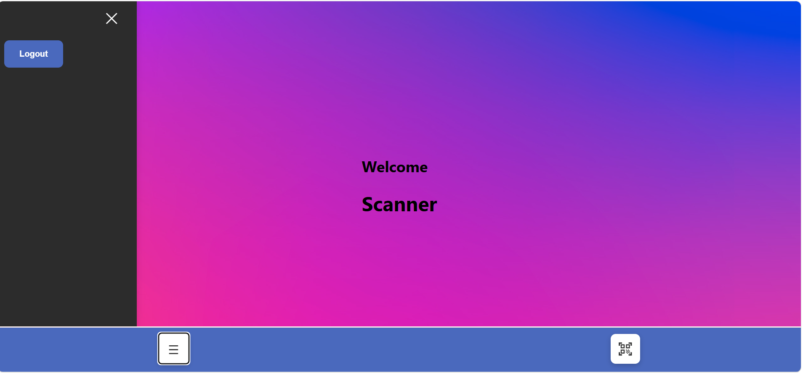

<<<<<<< HEAD
# 📱 Scanner Dashboard

### React-Based Login and QR Scanner Application

Scanner Dashboard is a React web application featuring a login interface and a dashboard with navigation, logout, and QR scanner access.

## ✨ Features

- 🔐 Login interface
- 📊 Dashboard with welcome screen
- 📷 QR scanner access
- ☰ Menu navigation
- 🚪 Logout functionality
- 🎨 Colorful user interface

## 🛠️ Technologies Used

- React.js
- JavaScript
- HTML5
- CSS3
- Create React App
- npm

## 📁 Project Structure

```text
login-page/
├── public/
├── src/
│   ├── App.js
│   ├── App.css
│   ├── index.js
│   ├── index.css
│   └── reference.js
├── package.json
├── package-lock.json
├── .gitignore
└── README.md
```

## 🚀 Installation and Setup

### Prerequisites

- Node.js
- npm
- Git

### 1. Clone the Repository

```bash
git clone https://github.com/SkRizwana26/scanner-dashboard.git
cd scanner-dashboard
```

### 2. Install Dependencies

```bash
npm install
```

### 3. Start the Application

```bash
npm start
```

Open `http://localhost:3000` in your browser, or use the local URL shown in your terminal.

## 📸 Screenshots


### Login Page


### Dashboard



### QR Scanner


*Ensure that the screenshot files exist and their filenames match these paths.*

## 🧪 Available Scripts

| Command | Description |
|---|---|
| `npm start` | Starts the development server |
| `npm test` | Runs tests |
| `npm run build` | Creates an optimized production build |
| `npm run eject` | Exposes the Create React App configuration; this is irreversible |

## 🔒 Security Notes

- Never upload passwords, API keys, or `.env` secrets.
- Implement proper authentication and authorization where required.
- Request camera permission if QR scanning uses the device camera.

## 👨‍💻 Author

**Alpha Crusaders Team**

## 📄 License

No license has been specified yet.

